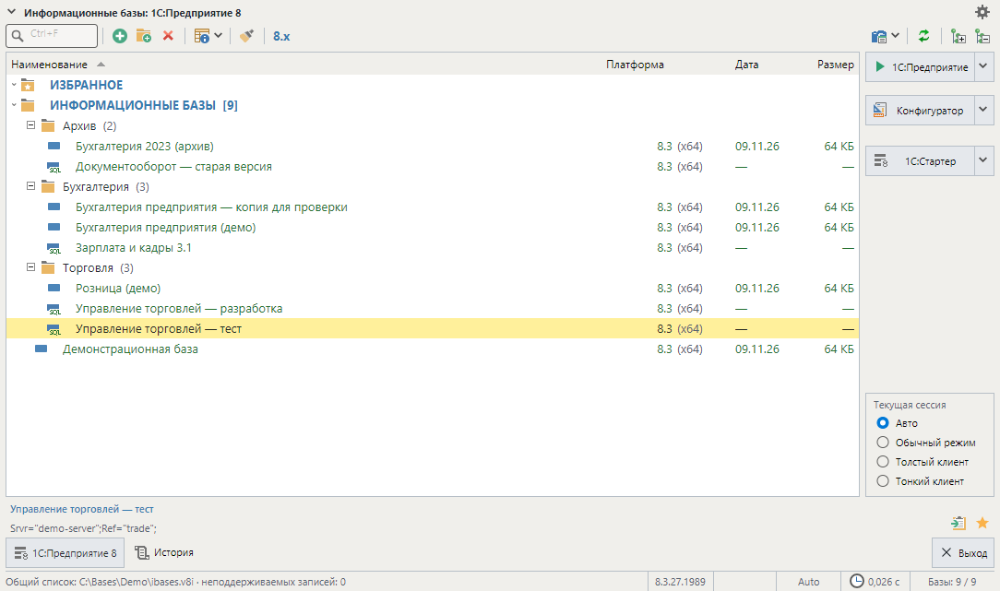

# БазоНавигатор

Список и запуск информационных баз 1С:Предприятие 8.x для Windows и Linux. Работает со стандартными
списками `.v8i` платформы, запускает предприятие и конфигуратор нужной версией клиента, хранит избранное
и историю. Написан на C# / .NET 10 / Avalonia 12; идеи интерфейса взяты из StartManager 1.4, но это
самостоятельная программа, а не его пересборка.



Этап разработки — **0.x**, текущая сборка **0.4.0.4** (номер показан в заголовке окна). Поддерживается
только 1С 8.x; 1С 7.7 и Snegopat не поддерживаются.

## Возможности

- **Списки баз.** При первом запуске открывается штатный список 1С (`%APPDATA%\1C\1CEStart\ibases.v8i`,
  в Linux `~/.1C/1cestart/ibases.v8i`). Можно выбрать любой общий `.v8i` или вести локальный список.
  Общий `.v8i` редактируется напрямую: неизвестные записи и параметры сохраняются, перед записью
  создаётся `.bak`, изменения другой программой обнаруживаются.
- **Каталог.** Поиск по наименованию или строке соединения, вложенные группы, файловые, серверные базы и базы
  на веб-сервере (`ws=`), отметка ненайденных файловых баз,
  сортировка по колонке и выбор колонок, свойства базы, переименование, перенос в группу, удаление подключения
  (сама база не удаляется), дублирование файловой базы с копированием её файлов, копирование наименования,
  ID, строки соединения и пути в буфер обмена.
- **Запуск.** Предприятие и конфигуратор. Версия клиента подбирается по `Version` записи, как в 1CEStart,
  либо по правилу «версия + разрядность» в настройках или свойствах базы, либо указывается файл вручную.
  В режиме «Авто» предприятие запускается через `1cv8s` подобранной версии с учётом `App=` списка;
  «Текущая сессия» задаёт на один запуск обычный режим, толстый или тонкий клиент.
  Если установлен только тонкий клиент `1cv8c`, им запускается предприятие; для конфигуратора нужен `1cv8`.
  В Windows — запуск от имени администратора (кнопка ▾ у кнопок запуска). База на веб-сервере запускается
  тонким клиентом (`/WS`) или открывается в браузере («Открыть в web-браузере» в меню ▾, `App=WebClient`).
- **Быстрый доступ.** Избранное отдельным разделом, история 100 запусков с повтором, ярлыки баз
  (`.lnk` / `.desktop`), контекстное меню и горячие клавиши.
- **Сведения о базе.** Платформа и разрядность, дата и размер файловой базы; отсутствующая версия зачёркнута.
- **Сервис.** Список установленных версий 1С («8.x»), открытие каталогов настроек и кэша базы, очистка
  временных файлов (кэш и настройки пользователя) для базы или всего списка с показом размера,
  завершение зависших клиентов 1С текущего пользователя (меню «Сервис»). «Сервис → Список информационных
  баз»: каталог и копия списка, редактор, удаление ненайденных баз, замена буквы диска. Поиск базы в списке по
  ID и поиск информационных баз на компьютере с добавлением найденных. В Linux очистка кэша и дублирование
  не трогают файлы, открытые процессами пользователя.
- **Оформление.** Светлая, тёмная и системная темы; шрифт и размер 10–24 отдельно для списка, панелей,
  заголовков и диалогов.
- **Резервирование.** Сценарии как в оригинале, выгрузка DT, CF и ZIP, список выгрузок, загрузка с откатом.
  DT и CF выгружает конфигуратор 1С в пакетном режиме, ZIP — файлы файловой базы; на время выгрузки можно поставить
  блокировку со случайным кодом доступа. Загрузка в серверную базу необратима — программа предупреждает об этом.
- **Запуск с параметрами** (меню ▾ у предприятия и конфигуратора): строка параметров, внешняя обработка и версия на один
  запуск. Постоянная строка задаётся в свойствах базы — поле «Дополнительные параметры» с кнопкой «…», как в оригинале.
  Она хранится в записи базы в списке `.v8i` (ключ `AdditionalParameters`) открытым текстом и поэтому действует и при
  запуске из стартера 1С (1CEStart); код `/UC` в ней увидят все, кто открывает список. Для списка только для чтения и
  для работы без файла списка строка хранится в настройках программы (JSON). Пароли в строке параметров не
  поддерживаются, вводите их в окне входа 1С. **Запуск с аутентификацией** (`Shift+F3` / `Shift+F4`) — с `/WA-`,
  имя и пароль вводятся только в окне 1С.
- **Пароли баз** (свойства → «Аутентификация») хранятся в папке настроек зашифрованными (AES-GCM, ключ в той же папке) и
  привязаны к списку баз; при запуске передаются 1С ключами `/N`, `/P`.
- **Импорт из StartManager.** Список `.v8i`, снимок `.v8sx`, избранное, поддерживаемые настройки и сценарии
  резервирования — с предпросмотром и без дублей.
- **Командная строка и журнал.** Выбор профиля и списка, запуск базы без окна, уровни журнала.

История выпусков — [CHANGELOG.md](CHANGELOG.md).

## Варианты поставки

| Вариант | Размер | Требования |
| --- | --- | --- |
| Автономный (сжатый single-file) | ~47 МБ | ничего; .NET внутри |
| Лёгкий | ~29 МБ Windows / ~24 МБ Linux | установленный .NET 10 Runtime |

Платформа 1С устанавливается отдельно. Программа — один исполняемый файл (`BaseNavigator.exe` или
`BaseNavigator`); рядом лежат `Assets/basenavigator.png` (значок для ярлыков Linux),
`THIRD-PARTY-NOTICES.txt` и в Windows `Start-with-log.cmd` для диагностики запуска.

## Установка и настройки

Скопируйте файлы из архива выпуска в любую папку и запустите. Настройки хранятся отдельно от программы
и при обновлении сохраняются (см. «Обновление»).

| Режим | Где хранятся настройки |
| --- | --- |
| Обычный (по умолчанию) | Windows `%LOCALAPPDATA%\BaseNavigator`, Linux `~/.config/BaseNavigator` |
| Портативный | папка `Settings` рядом с программой (включается файлом-меткой `BaseNavigator.portable`) |

Режим переключается в **Настройки → Общее** (действует после перезапуска) или ключами `--portable` / `--normal`
на один запуск. В профиле: `library.json` — настройки и локальный список, `library.json.activity.json` —
избранное и история, `logs/` — журнал.

Портативную папку можно переносить и копировать: при открытии программа сама пересчитывает пути внутри папки
(выбранный список, клиенты 1С, файловые базы локального списка), избранное и историю. Содержимое файлов `.v8i`
не переписывается — как и в 1С, в них хранятся абсолютные адреса. Ярлыки баз после переноса создаются заново.

**Ярлык в меню приложений (Linux).** Настройки → «Общее» → «Меню приложений»: «Создать ярлык» / «Удалить ярлык» (действуют
сразу), без окна — `BaseNavigator --install-desktop` / `--uninstall-desktop`. Создаются `basenavigator.desktop` в
`~/.local/share/applications` и значок в `~/.local/share/icons/hicolor` (с учётом `XDG_DATA_HOME`). Ярлык указывает на
текущий файл программы: после переноса папки создайте его снова — повторное создание обновляет путь. Удаление убирает только
файлы, созданные программой.

## Обновление

Начиная с 0.2.0.21 программа обновляется сама из выпусков GitHub. С 0.4.0.3 выпуски публичного репозитория
берутся напрямую по HTTPS, без входа и без `gh`; прокси — системный (Windows) или из переменной окружения `HTTPS_PROXY`.
Если HTTPS не ответил (нет сети, лимит запросов GitHub, закрытый «другой репозиторий»), используется GitHub CLI,
если он установлен: нужен выполненный вход `gh auth login` (токен хранит `gh`, программа его не читает).
Версии до 0.4.0.3 обновляются только через `gh`: без него 0.4.0.3 один раз ставят вручную (см. ниже).

**Настройки → Автообновление:**

| Способ обновлений | Что происходит при запуске программы |
| --- | --- |
| Проверять обновления и уведомлять пользователя | в строке состояния появляется сообщение о новой версии |
| Загружать обновления автоматически | новая версия скачивается в фоне и устанавливается после закрытия программы |
| Не проверять обновления автоматически (по умолчанию) | ничего; проверка — кнопкой «Проверить сейчас» |

Там же «Установить обновление», «Восстановить версию…» и «Хранить прежних версий» (1–10, по умолчанию 3), а также
можно указать другой репозиторий с выпусками.
Скачивается тот же вариант поставки и та же платформа, что установлены (автономный или лёгкий).

**Ход загрузки.** «Установить обновление» и «Загрузить» в окне предложения показывают этап и полосу: «Загрузка
обновления… N из M МБ», проверка контрольной суммы, распаковка, пробный запуск; кнопки на это время недоступны. Закрытие
окна во время загрузки отменяет её, недокачанная папка `.update-*` удаляется. При способе «Загружать автоматически» процент
показывается в строке состояния главного окна.

**Если проверка не удалась** (нет сети, GitHub ограничил запросы, нет доступа к репозиторию), автоматическая проверка при
запуске сообщает об этом в строке состояния: «Автоматическая проверка обновлений не выполнена: …» — причина по HTTPS и,
если пробовался `gh`, его ответ. Для закрытого репозитория выполните `gh auth login` (проверить вход — `gh auth status`) и
нажмите «Проверить сейчас» или перезапустите программу.

**Как устроена установка:**
- загрузка по HTTPS идёт только по `https://` (и при перенаправлениях), файл не может быть больше размера, указанного
  GitHub, и сохраняется под своим именем только целиком;
- архив сверяется с контрольной суммой GitHub (`digest`, если есть) и с `SHA256SUMS.txt`, новая версия пробно запускается
  с `--version`;
- заменяются только файлы программы (exe, `Start-with-log.cmd`, `THIRD-PARTY-NOTICES.txt`, `Assets/`) —
  настройки, `Settings/` и метка портативного режима не трогаются;
- текущая версия целиком сохраняется в архив `.versions/<версия>/` рядом с программой (копия той же версии
  заменяется новой, лишние самые старые удаляются после успешной установки); если сбой случился до завершения замены,
  прежние файлы возвращаются, если после — установка завершается; прерванная установка доводится до одного из этих
  состояний при следующем запуске;
- из окна обновление и откат применяются после закрытия программы (кнопка «Перезапустить сейчас» делает это сразу);
  до перезапуска новые операции недоступны.

**Восстановление версии:** «Сервис ▾ → Восстановить версию…» или кнопка на странице «Автообновление» — окно со
списком версий из архива; без окна — `BaseNavigator --rollback` (последняя сохранённая; повторный вызов возвращает
обратно) или `--rollback 0.3.0.7`. Если новая версия вообще не запускается, запустите сохранённую копию:
`.versions/0.3.0.7/BaseNavigator.exe --rollback` (Linux: `.versions/0.3.0.7/BaseNavigator --rollback`).
Папка `.previous` прежних сборок показывается как ещё одна сохранённая версия и переносится в архив при следующей
установке или восстановлении.

**Без окна:** `BaseNavigator --check-update` (код 8 — доступна новая версия), `--update`, `--rollback`
(код 7 — операция не выполнена).

Вручную (например, с версии до 0.4.0.3 без `gh`): закройте программу и распакуйте архив выпуска поверх папки программы.

**Как это устроено внутри.** Работающая программа никогда не заменяет свой файл: окно и фоновая загрузка
подготавливают выпуск в `.pending-update`, а применяет его отдельный помощник (копия программы) после закрытия всех
окон программы. Каждая копия, которой удалось зарегистрироваться, держит `.run.lock` в общем режиме, помощник —
эксклюзивно; пока он заменяет файлы, новый запуск ждёт и продолжается уже с новой версии. Прерванная установка восстанавливается помощником при следующем
запуске. Журнал помощника — `.update-helper.log` рядом с программой.

Ограничения автообновления — в разделе «Ограничения».

## Работа со списком

Все настройки — в одном окне: **шестерёнка → раздел слева**, кнопки «Применить» / «Сохранить» / «Закрыть» внизу.
Правая кнопка мыши (или `Shift+F10`) открывает действия для строки.

| Клавиша | Действие |
| --- | --- |
| двойной щелчок | запуск (предприятие или конфигуратор — задаётся в «Общее») |
| `F3` / `F4` | 1С:Предприятие / конфигуратор |
| `Shift+F3` / `Shift+F4` | то же с аутентификацией: имя и пароль запросит 1С (`/WA-`) |
| `Ctrl+D`, `F8` | добавить в избранное или убрать |
| `Ctrl+J` | перейти к разделу «Избранное» |
| `F2` | переименовать |
| `Alt+Enter` | свойства базы или группы |
| `Shift+Ctrl+M` | переместить в группу |
| `Ins` / `Ctrl+Ins` | новое подключение / новая группа |
| `Del` | удалить подключение (база не удаляется); у ярлыка избранного — убрать из избранного |
| `Shift+Ctrl+F5` / `Shift+Ctrl+F7` | выгрузить резервную копию / загрузить из резервной копии |
| `Alt+F10` | меню «Сервис» |

## Командная строка

```text
BaseNavigator [--settings <файл>] [--portable | --normal] [--single-instance] [--list <список.v8i>]
BaseNavigator [параметры] --launch <GUID> [--mode enterprise|designer] [--no-gui]
BaseNavigator --help | --version
BaseNavigator --check-update | --update | --rollback [<версия>]
BaseNavigator --install-desktop | --uninstall-desktop    # только Linux
```

`--list ""` открывает локальный список; `--log-level off|error|warning|info|debug` и `--log-dir <путь>` меняют
журнал на один запуск. Полная справка и коды завершения — `BaseNavigator --help`.

## Диагностика

Журнал пишется в `logs/` профиля (уровень — в **Настройки → Общее**). Если программа в Windows не запускается,
используйте `Start-with-log.cmd`: он включает подробный журнал и трассировку загрузки .NET и открывает папку с результатом.

## Ограничения

**Переход с 0.3.0.x.** Пароли, сохранённые версиями 0.3.0.x, при первом запуске 0.4.0.0 удаляются (см.
[CHANGELOG.md](CHANGELOG.md), 0.4.0.0); возврат на прежнюю версию их не восстанавливает.

**Автообновление** рассчитано на установку одного пользователя на локальном диске:
- контрольная сумма берётся из того же выпуска (`SHA256SUMS.txt`): она защищает от повреждённой загрузки, но не от подмены
  выпуска тем, кто может публиковать выпуски выбранного репозитория (это не подпись); новая версия запускается для пробы
  (`--version`) до установки;
- при загрузке через `gh` отмена завершает только сам процесс `gh`; его дочерние процессы, если они есть, могут продолжить работу (тогда
  папка `.update-*` убирается при следующем запуске);
- на Linux отмена требует ядра с pidfd (5.3 и новее); без него процесс `gh` не завершается, и отмена сообщает, что не
  выполнена до конца: «Не удалось остановить GitHub CLI (gh) безопасно…»;
- общая папка программы для нескольких пользователей ОС с разными правами не поддерживается; копия, которой не
  удалось открыть `.run.lock`, работает без регистрации и не защищена от замены файлов, если доступ к нему потом
  восстановят, не перезапустив её;
- на Linux на сетевых ФС без поддержки `flock` (часть NFS/SMB) и при отключённых блокировках .NET
  (`DOTNET_SYSTEM_IO_DISABLEFILELOCKING`) безопасность одновременных запусков не гарантируется; копия, запущенная
  с отключёнными блокировками, сама обновление не применяет, но от копии с другим окружением это не защищает;
- если помощник был приостановлен больше суток до начала работы, перезапуск после установки может не произойти
  (файлы программы при этом не страдают).

**Общий список на сетевой папке.** На Linux файловые блокировки .NET не берут `flock` для записи на NFS/SMB: одновременная
запись общего `.v8i` с двух компьютеров защищена только сравнением содержимого перед записью (и отметкой прерванной записи).

**Резервирование:**
- блокировка ИБ для выгрузки на Linux ставится через жёсткую ссылку; на файловых системах без жёстких ссылок (общая папка
  VMware `hgfs`, некоторые SMB) кнопка «Установить блокировку ИБ» блокировку не ставит и сообщает причину;
- пакетному конфигуратору на Linux нужен графический сеанс (X-дисплей) и лицензия 1С пользователя;
- предел времени работы 1С из окна — 6 часов; архивы больше 4 ГБ и открытие томов ZIP самим 7-Zip не проверялись.

**Интерфейс:**
- перетаскивания баз и групп мышью нет — используйте «Переместить в группу…» (`Shift+Ctrl+M`);
- на Linux мост AT-SPI Avalonia отдаёт экранным дикторам не всё дерево: строки списка, появившиеся после открытия окна,
  пункты раскрытого выпадающего списка вне видимой области; у пунктов меню нет действий; пока открыт диалог выбора каталога
  портала, дерево программы не отвечает.

**Не проверено:** серверная база с настоящим кластером 1С (только аргументы запуска и отказы), Wayland, KDE и GNOME вживую,
обновление с настоящим GitHub в сквозных сценариях (там подменные `gh` и HTTP; живая проверка — при выпуске).

## Как сделано

Код, тесты и проверки написаны ИИ-агентами под руководством автора проекта: он ставил задачи, принимал решения и проверял
результат. Реализация — Claude (Anthropic) и Codex (OpenAI); независимый аудит каждого существенного изменения — другой моделью,
чем автор: Codex, Grok (xAI), на отдельных шагах — Claude Fable. Перед выпуском — сквозные сценарии на Windows и Linux и полный
аудит кода. В коммитах выгрузки агенты указаны соавторами (`Co-Authored-By`).

## Сборка

Нужен .NET SDK 10. Результат — в `dist/<платформа>[-light]/`, ничего не устанавливается.

```bash
./build.sh                       # Linux: автономный вариант для этой системы
./build.sh --light --test        # лёгкий вариант, перед сборкой — тесты
./build.sh --runtime win-x64     # сборка для другой платформы
```

```powershell
.\build.ps1                      # Windows: автономный вариант win-x64
.\build.ps1 -Light -Test         # лёгкий вариант, перед сборкой — тесты
.\build.ps1 -Runtime linux-x64   # сборка для другой платформы
```

То же вручную: `dotnet publish src/StartManager/StartManager.csproj -c Release -r <rid> --self-contained
-p:PublishSingleFile=true -p:IncludeNativeLibrariesForSelfExtract=true` (для лёгкого варианта `--no-self-contained`:
форму `--self-contained false` SDK 10.0.1xx понимает как автономную сборку).
Тесты: `dotnet test src/StartManager.Tests -c Release`.


## Структура

| Путь | Содержимое |
| --- | --- |
| `src/StartManager` | приложение Avalonia: окна, диалоги, запуск |
| `src/StartManager.Core` | ядро без UI: списки `.v8i`, профиль, платформы, запуск, журнал |
| `src/StartManager.Tests` | тесты xUnit |


## Лицензия

БазоНавигатор распространяется по лицензии MIT — см. [LICENSE](LICENSE). Лицензии сторонних компонентов
(Avalonia, .NET и других) — в [THIRD-PARTY-NOTICES.txt](THIRD-PARTY-NOTICES.txt).
